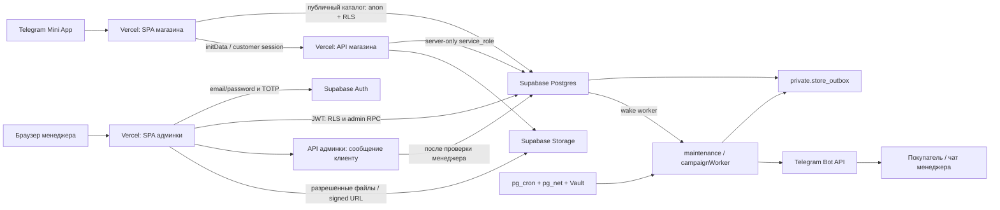
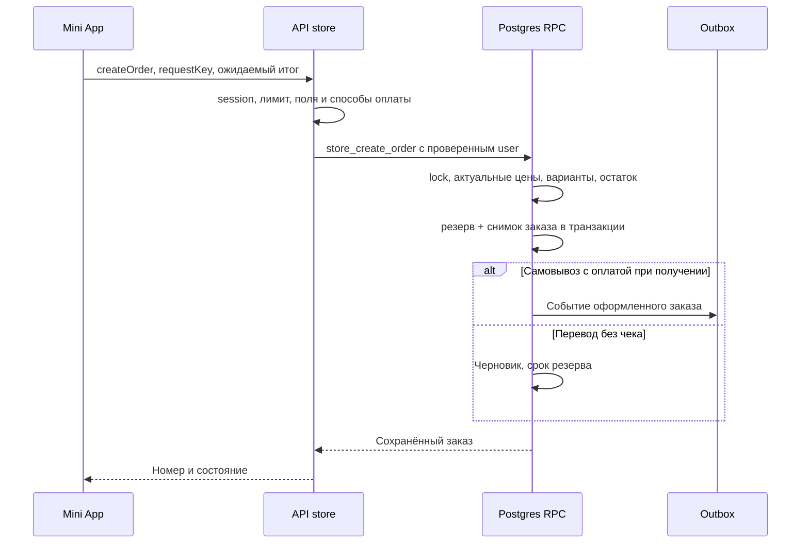
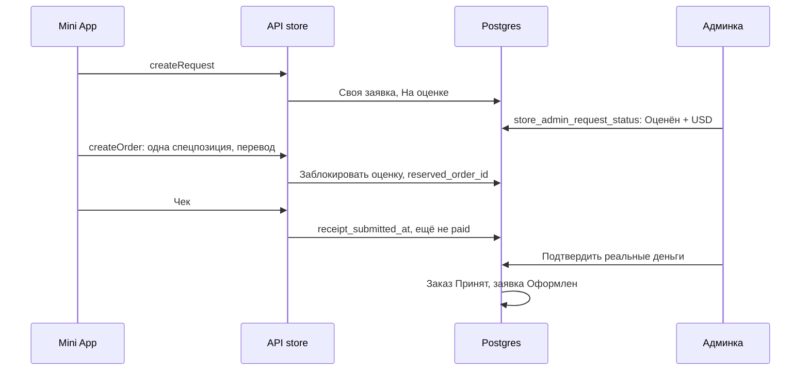
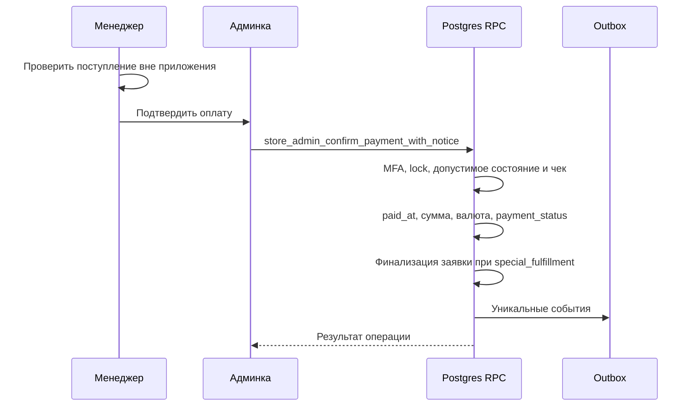
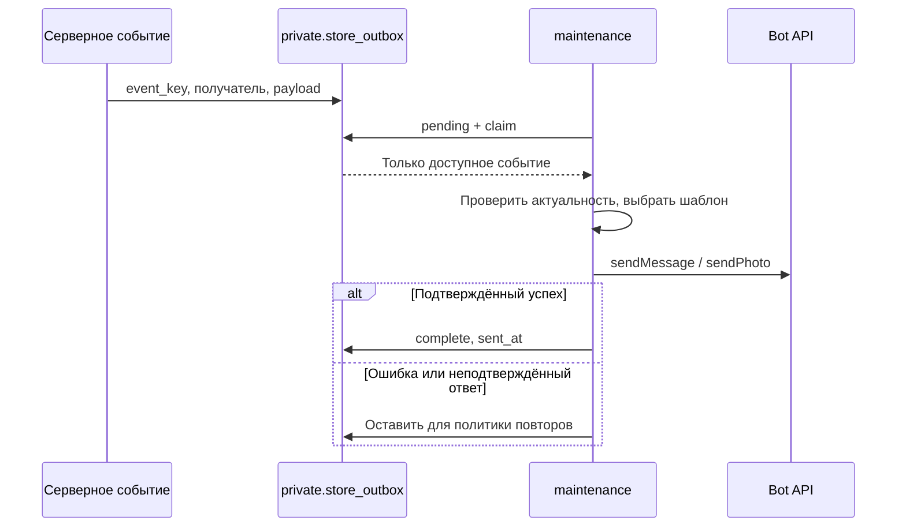
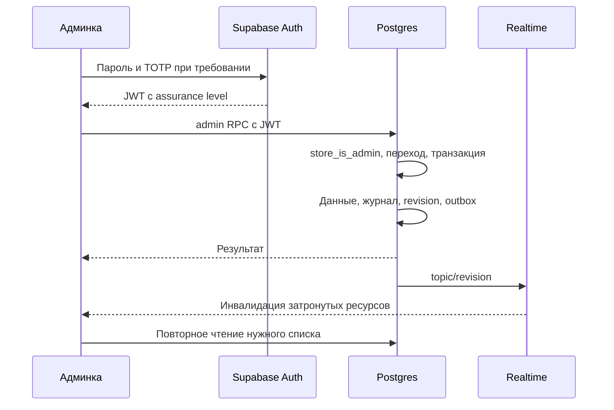

# LOFT Store — техническая архитектура

Сверено с исходниками на 17.11.2026: `loft-store` `b9b9e99`, админка `7355765`. Это описание кода, не акт проверки production. [Продукт и статусы](PRD.md), [дизайн](DESIGN_SYSTEM.md), [AGENTS](../AGENTS.md), [архитектура админки](https://github.com/ttta999/loft-store-admin/blob/main/docs/ARCHITECTURE.md).

## Общая схема



Два независимых SPA используют один серверный домен данных. Клиентские приватные действия идут через API магазина; менеджерские — преимущественно напрямую в защищённые RPC Supabase. Серверные функции админки не являются отдельным дублем всего клиентского API.

## Технологии и структура

Источник версий: [package.json](../package.json), [lockfile](../package-lock.json), [package.json админки](https://github.com/ttta999/loft-store-admin/blob/main/package.json). React 19, TypeScript 6, React Router 7, Vite 8, Tailwind CSS 4, Supabase JS 2, Lucide/React Icons, Sonner. Магазин дополнительно использует Zustand и Framer Motion; `sharp` обрабатывает изображения на сервере. `@twa-dev/sdk` объявлен зависимостью, но фактическая интеграция в просмотренных исходниках идёт через `window.Telegram.WebApp` и Telegram script, а не найденный импорт этого пакета. Админка использует native Web Animations/View Transitions, без зависимости от Framer Motion/Zustand. Тесты: Node test runner, Playwright и отдельный PGlite для SQL. Это не Next.js, не SSR и не платёжный gateway.

[Наблюдатель SDK](../public/loft-sdk.js) регистрирует результат загрузки асинхронного скрипта до первого выполнения React. [Точка входа](../src/main.tsx) использует уже известный результат либо ожидает не дольше текущего таймаута. Ошибка выводит экран восстановления. Предварительные [данные отображения Telegram](../src/lib/telegramDisplayUser.ts) содержат только имя, username и HTTPS-аватар. Они живут в памяти до серверной проверки. Приватные запросы используют подписанный initData прежним способом.

| Каталог | Ответственность |
|---|---|
| `src/pages/` | Клиентские экраны |
| `src/components/` | Переиспользуемые поверхности, поля, навигация, диалоги |
| `src/lib/` | API, кеш, деньги, переходы, размеры, даты, deep links |
| `src/store/useStore.ts` | Zustand: язык/тема/валюта, корзина, избранное, кеш каталога |
| `api/` | Vercel handlers; отдельно от Vite dev server |
| `server/` | Авторизация, HTTP-проверки, форматирование уведомлений, worker helpers |
| `supabase/migrations/` | Версионированные изменения SQL; читать последние замены функций |
| `db/` | Исторические установочные/охранные SQL-скрипты; не новая альтернативная миграционная история |
| `tests/`, `tests/sql/`, `e2e/`, `scripts/` | Unit, SQL, браузерные фикстуры, проверки сборок и CSP |
| `docs/`, корневые security/testing/cache документы | Текущие документы и исторические отчёты |
| `graphify-out/` | Производная карта связей, не источник бизнес-правил |

## Клиентское приложение

[App.tsx](../src/App.tsx) собирает BrowserRouter, тему, Telegram-интеграцию и общую навигацию. Основные пути: `/`, `/home`, `/search`, `/cart`, `/china`, `/profile`; дополнительные `/product/:id`, `/favorites`, `/catalog`, `/brands`, `/category`, `/all-products`, `/privacy`, `/terms`.

Профиль использует query-параметры `section`, `order`, `request`; категории/каталог и подборки также передают контекст через router state. Нельзя считать всё состояние адресуемым только pathname. `ProductRoute` получает ключ history entry: вложенные товары сохраняют отдельный контекст.

[pagePreload](../src/lib/pagePreload.ts) предзагружает lazy-модули. [AnimatedRoutes](../src/components/AnimatedRoutes.tsx) держит отображаемую локацию до подготовки перехода. [tabTransition](../src/lib/tabTransition.ts) двигает контент разделов; [productTransition](../src/lib/productTransition.ts) связывает конкретное фото карточки и hero. `placement` отличает повторяющийся товар в нескольких подборках. `ScrollRestoration` и `usePageState` восстанавливают прокрутку/фильтры по записи истории. Подробнее о длительностях и fallback: [дизайн](DESIGN_SYSTEM.md).

## Административная панель

Её собственные исходники и документация: [App](https://github.com/ttta999/loft-store-admin/blob/main/src/App.tsx), [архитектура](https://github.com/ttta999/loft-store-admin/blob/main/docs/ARCHITECTURE.md).

Вход — Supabase email/password, разрешённый администратор и, при требовании, TOTP. `ProtectedLayout` перепроверяет сессию/роль и запускает `useAdminLive`. Просмотр использует разрешённые RLS-запросы. Изменение заказов, подтверждение денег, отмены, возвраты, редактирование вариантов и рассылки выполняются RPC. Внешний вид кнопки не заменяет серверную проверку.

## Серверное API

[api/store.ts](../api/store.ts) — POST JSON action-router. [server/http.ts](../server/http.ts) задаёт проверку метода/размера/JSON, общую обработку ошибок, rate limit и получение проверенного пользователя. Приватные ответы имеют `Cache-Control: no-store`.

| Handler | Контракт/назначение |
|---|---|
| [validateTelegram](../api/validateTelegram.ts) | POST `initData`, проверка подписи, выпуск/регистрация customer session |
| [store](../api/store.ts) | `orders`, `requests`; `createOrder`, `cancelOrder`, `createRequest`, `cancelRequest`; `upload`; `preferences`, `savePreferences`; `restocks`, `subscribeRestock`, `cancelRestock`; `language`, `marketingConsent`, `subscribe`, `prepareShare` |
| [getExchangeRate](../api/getExchangeRate.ts) | Курс для существующей логики магазина; не банковская котировка исполнения платежа |
| [publicConfig](../api/publicConfig.ts) | Безопасная публичная конфигурация ссылки Mini App |
| [maintenance](../api/maintenance.ts) | Авторизованный POST worker операционных очередей, напоминаний, поступлений и уборки файлов |
| [campaignWorker](../api/campaignWorker.ts) | Авторизованный POST worker рассылок, отдельные lease/throttle/outcomes |
| [sendNotification](../api/sendNotification.ts) | Старый клиентский способ отключён: HTTP 410 |

`store` получает пользователя из session, а не из `user_id` тела. История читается страницами по 100 с `cursor/hasMore/nextCursor`; [api.ts](../src/lib/api.ts) собирает её целиком с защитой от повторного cursor. Не удалять фильтр `checkout_abandoned_at` и условия показа перевода без чека. `createOrder` содержит `requestKey` UUID и ожидаемый итог; повтор ключа не означает новое списание.

## Supabase: модель и связи

| Данные | Связи и ограничения |
|---|---|
| `products`, `categories`, `subcategories`, `brands` | Категория товара — `category`, подкатегория — `subcategory`; есть активность. Бренд товара в UI часто сопоставляется через `brand`/имя; не предполагать универсальный FK `brand_id` во всех объектах |
| `product_colors`, `product_variants` | Цвета и складские варианты принадлежат товару; вариант определён товаром/размером/цветом. Raw остатки не предназначены публичному браузеру |
| `orders` | Пользователь, items-снимок, суммы/валюта/курс, платежи, raw-статус, резерв, отмена и специальный workflow |
| `china_requests` | Заявка, оценка, `reserved_order_id`, `converted_to_order_id`; одна новая заявка → одно отдельное оформление |
| `refunds` | Один финансовый возврат на отменённый заказ; назначение, сумма/валюта, квитанция, аудит |
| `size_charts` | Область товар/бренд/подкатегория/категория, RU/UZ колонки, строки, необязательный `size_mapping` |
| `subscribers`, `product_popularity`, `settings` | Адресат бота, агрегат популярности, настройки цен/курса/доставки/реквизитов |
| `store_data_revisions` | Только topic/revision для инвалидации админки, не клиентские записи |
| `campaigns` | Кампания и агрегаты, публичная схема с доступом только менеджеру |
| `private.store_customer_preferences` | Контакты, адреса, системы размеров, язык и маркетинговое согласие; service-only RPC |
| `private.store_admins`, `private.store_sessions`, `private.store_limits` | Разрешённые менеджеры, хеши customer session, лимиты |
| `private.store_outbox`, `private.store_notification_config` | Очередь и worker-конфигурация |
| `private.store_order_events`, `private.store_refund_audit`, `private.store_payment_reviews`, `private.store_payment_audit` | Журнал событий и финансовых действий; не подмена факта движения денег |
| `private.store_reminder_settings`, `private.store_reminder_deliveries` | Правила и отметки доставки напоминаний |
| `private.store_restock_subscriptions`, `private.store_restock_candidates` | Подписки на вариант и кандидаты уведомления |
| `private.store_campaign_recipients`, `private.store_campaign_tests`, `private.store_campaign_throttle`, `private.store_bot_delivery_state` | Фиксированная аудитория, тестовые отправки, ограничение темпа, недоступные чаты |

Ключевые RPC: `store_create_order`, `store_cancel_order`, `store_create_request`, `store_cancel_request`, `store_save_screenshot`; `store_admin_order_status`, `store_admin_request_status`, `store_admin_confirm_payment_with_notice`, `store_admin_cancel_order_reason`, `store_admin_refund_action`; `store_admin_save_product_recommendations`, `store_admin_variants`, `store_admin_size_chart`; `store_customer_preferences`, `store_customer_language`, `store_restock`; `store_admin_tasks`, `store_admin_order_history`, `store_admin_reminder_settings`, `store_admin_campaign_action`. Контракт аргументов проверять в последней миграции и месте вызова, не восстанавливать по названию.

Опорные SQL: [security architecture](../supabase/migrations/20261106154106_security_architecture.sql), [специальное выполнение](../supabase/migrations/20261111133039_special_order_fulfillment.sql), [отмена/возврат](../supabase/migrations/20261112120358_order_refunds.sql), [действующие переходы](../supabase/migrations/20261112172104_streamline_delivery_and_special_notices.sql), [предпочтения](../supabase/migrations/20261113162424_store2_customer_preferences.sql), [журнал/задачи](../supabase/migrations/20261113170735_store2_history_and_tasks.sql), [кампании](../supabase/migrations/20261113173520_store2_campaigns.sql), [метаданные размеров](../supabase/migrations/20261117110219_explicit_size_chart_mapping.sql).

Новые изменения схемы — новые миграции. Не редактировать применённый файл, не переигрывать `db/` на работающей базе, не отключать RLS. При переносе схемы сначала установить необходимый baseline/расширения и проверить зависимости; SQL-фикстура тестов не является резервной копией магазина.

## Авторизация и безопасность

[server/auth.ts](../server/auth.ts) проверяет HMAC Telegram initData, дубли ключей, пользователя и время: до 300 секунд давности, не более 30 секунд в будущем. Из проверенного пользователя выпускается HMAC customer session на 12 часов. Сервер регистрирует хеш токена; на приватном запросе проверяет подпись/срок и `store_validate_session` в БД, включая отзыв. `initDataUnsafe` не даёт права на финансовую операцию.

Административный JWT выпускает Supabase Auth. [store_is_admin](../db/10_enforce_admin_mfa.sql) проверяет allowlist, реальную auth session, срок сессии, при `mfa_required` — `aal2` и verified-фактор. Нельзя полагаться на локальный `adminLoggedIn`, только frontend guard или редактируемый `user_metadata`.

| Сторона | Разрешения |
|---|---|
| Публичный anon | Разрешённые активные данные каталога/settings и RPC доступности; не все таблицы `public` доступны |
| Покупатель | Свои действия через проверенный API; service-only RPC не открывается браузеру |
| Менеджер | JWT + RLS + `store_is_admin` внутри критичных RPC |
| Сервер | `SUPABASE_SERVICE_ROLE_KEY`; проверяет пользователя/роль до привилегированного действия |
| Worker | Проверенный bearer через `store_worker_authorized`; секрет берётся из окружения/Vault |

Секреты не префиксовать `VITE_`, не логировать Bot API URL с токеном. Состояние оплаты, возврата и склада меняется атомарно с row/advisory locks и ключами повторов. Прямые browser update финансовых/складских таблиц не заменяют RPC.

Storage: `payment-screenshots`, `china-requests`, `refund-proofs`, `campaign-media` содержат защищённые файлы. Клиентская загрузка проверяется сервером/квотой/владельцем; административные загрузки и чтение — соответствующими политиками. В записи хранится `private:bucket/path`, на чтение выпускается временный signed URL. Не превращать private bucket в public ради предпросмотра. Фото каталога и логотипы — другая область публичных файлов. [images](../server/images.ts), [загрузка клиента](../api/store.ts), [refund proof](../supabase/migrations/20261112120358_order_refunds.sql).

## Потоки операций

### Создание обычного заказа



### Заявка и оформление спецзаказа



### Подтверждение оплаты



### Отправка уведомления



Общая outbox снижает дубли, но Bot API не имеет транзакции с Postgres. Сбой после фактической отправки до `complete` остаётся отдельным риском. У кампаний более строгая обработка `uncertain`: не смешивать её с операционной очередью.

### Админка и Supabase



## Telegram и фоновые задачи

В репозитории есть интеграция Mini App, формирование ссылок и исходящие Bot API вызовы. Полного webhook/long-polling обработчика команд бота не найдено. Не придумывать его местонахождение: проверить внешний сервис у владельца.

[links](../server/links.ts), [launchTarget](../src/lib/launchTarget.ts) и `LaunchTarget` обслуживают product/variant и кампанийные ссылки с проверкой назначения. Сохранять формат при изменении маршрутов. Фото для шаринга подготавливается сервером; URL/редиректы и содержимое ограничиваются соответствующими helpers.

`pg_cron` в миграциях планирует maintenance и campaign worker раз в минуту; `pg_net` вызывает Vercel, Vault хранит worker-секрет. События дополнительно будят worker. [maintenance](../api/maintenance.ts) ставит напоминания и поступления, убирает orphan files и доставляет outbox. [campaignWorker](../api/campaignWorker.ts) выполняет ограниченный batch; отдельно учитывает lease, rate limiting, 429, блокировку чата и неопределённый результат. Факт существования SQL job не доказывает, что production job активен и секреты настроены.

## Кеширование и Realtime

| Слой магазина | Фактическое поведение |
|---|---|
| `ResourceCache` | Ограниченный memory cache, TTL, dedup pending, revision invalidation; ошибки не становятся данными |
| Zustand persist `loft-store` | Язык/тема/валюта, корзина, избранное и снимки каталога; не серверное подтверждение наличия |
| HTTP `dataFetch` | Только успешные допустимые чтения; auth/stock/RPC/abortable запросы обходят HTTP-кеш по условиям кода |
| `api.ts` | Приватные чтения 15 секунд, ключ с user id, очистка при смене initData/401/мутации |
| `productCache` | Товар 5 минут, размеры 30 секунд |
| `productSizeChart` | Строки категории и результат области товара 30 секунд; timeout 8 секунд; focus/visibility/периодическая проверка |
| `usePageState`, `ScrollRestoration` | UI-контекст по history key, не второй источник серверных данных |

Клиент не использует `useAdminLive`. В админке отдельный cache scope JWT/пользователя, чтения и Realtime revisions с polling fallback 30 секунд. Общего бессрочного кеша всех страниц или полноценного offline-first режима нет. Размерные таблицы после изменения менеджером перепроверяются на клиенте фоном, а не синхронным междоменным invalidate. См. [админский кеш](https://github.com/ttta999/loft-store-admin/blob/main/docs/ARCHITECTURE.md).

## Локализация и время

UI магазина использует `language` Zustand и существующие RU/UZ тексты; админка — типизированные словари `t/tx` с отдельным scope менеджера. Не переводить SQL-идентификаторы и raw-статусы в базе.

`LanguageSync` гидратирует язык проверенного аккаунта; гидратация и Telegram fallback не считаются явным выбором. Явное изменение сохраняется через `language`. `language_source`, `telegram_language`, `onboarding_completed_at` относятся к приватным настройкам аккаунта. `completeOnboarding` требует явного RU/UZ, повтор не изменяет timestamp. [Onboarding](../src/components/Onboarding.tsx) перекрывает текущую цель, не переписывая её URL; Telegram Back не обходит обязательный выбор. [customerLanguage](../server/customerLanguage.ts) читает язык перед форматированием недоставленного события и кампании: explicit → Telegram → ru. [customerTexts](../server/customerTexts.ts) локализует фиксированные части, сохраняя экранированные подстановки. Менеджерские/свободные сообщения не переводятся; event keys, lease, суммы и дедупликация прежние. Полного inbound-обработчика бота нет.

[dateTime](../src/lib/dateTime.ts) использует `Intl.DateTimeFormat().resolvedOptions().timeZone`, RU/UZ locale, UTC timestamps и совместимость с legacy UTC без суффикса. Геолокации/IP-определения нет. Новое планирование рассылки: местный ввод → `localInputToUtc` → ISO UTC; последующая смена зоны не двигает инстант. Рабочие часы сервер проверяет в `Asia/Tashkent`; админский `workHours` проецирует их в местную зону менеджера. Исторические timestamps не пересчитывать.

## Развёртывание

[Vercel config](../vercel.json) переписывает SPA-маршруты в `index.html`, исключая `api/` и `assets/`; задаёт CSP и защитные headers. HTML: revalidate (`max-age=0, must-revalidate`), versioned assets: год + immutable. `campaignWorker` имеет `maxDuration: 60`. Vercel Cron в этом файле нет: фоновые вызовы описаны в SQL.

Frontend: `VITE_SUPABASE_URL`, `VITE_SUPABASE_ANON_KEY`. Сервер: `SUPABASE_URL` или его VITE fallback, `SUPABASE_SERVICE_ROLE_KEY`, `TELEGRAM_BOT_TOKEN`, `TELEGRAM_MANAGER_BOT_TOKEN`, `TELEGRAM_MANAGER_CHAT_ID`; дополнительные bot/deep-link/test параметры читать в `server/links.ts`, `server/campaignDelivery.ts`. Здесь только имена, не значения. [.env.example](../.env.example) — неполная шпаргалка, не доказательство состава окружения.

Сайты сессии разработки: `loft-store-24bz.vercel.app` и `loft-store-admin.vercel.app`. Привязка GitHub/Vercel, секреты и текущие jobs требуют отдельной эксплуатационной проверки. [SECURITY-OPERATIONS](../SECURITY-OPERATIONS.md) содержит исторические инструкции; не выполнять их автоматически при чтении документа.

## Тестирование

Команды из [package.json](../package.json):

```sh
npm ci
npm run dev
npm test
npm run build
npm run lint
LOFT_ADMIN_ROOT=/absolute/path/to/loft-store-admin npm run test:e2e
LOFT_ADMIN_ROOT=/absolute/path/to/loft-store-admin npm run test:all
LOFT_ADMIN_ROOT=/absolute/path/to/loft-store-admin npm run test:csp
```

`build`: `tsc -b`, серверный `tsc`, затем Vite; отдельного npm `typecheck` нет. `test:all` выполняет unit обеих сторон, обе сборки и общий e2e, **не** добавляет lint/все SQL-тесты автоматически. `test:csp` использует готовые `dist`.

```sh
npm ci --prefix tests/sql --ignore-scripts
node scripts/test-store2-db.mjs
```

Это изолированный PGlite с fixture baseline, без подключения к рабочей БД. Остальные SQL-файлы `tests/` требуют своих исходных условий; не запускать их в production. Playwright [конфигурация](../playwright.config.ts), [серверы](../scripts/test-servers.mjs) и [фикстуры](../e2e/fixture.ts) подменяют сеть и поднимают оба SPA на 4173/4174. Проекты mobile Chromium, desktop Chromium, WebKit с iPhone viewport. Node/runtime для прямого запуска `.ts` должен поддерживать этот синтаксис; `engines` в package.json не фиксируется. Физический iPhone и Telegram WebView не объявлять проверенными по результату эмуляции.

## Ограничения и расхождения

- Корневые README до этой задачи оставались шаблоном Vite. Их шаблонные рекомендации не являются перечнем реализованных функций.
- Исторические отчёты описывают прежние анимации/статусы, смешанные спецкорзины, часовые пояса и уже отключённый endpoint. Новые документы сохраняют различие raw/UI и порядок последних SQL-замен.
- `motionTiming.sheetOpen=0.34` не задаёт фактическую панель размера: в `SizeSelector` значения 0.25/0.20. Админские кривые также отличаются. Это задокументированное различие, без исправления кода.
- Нет полного обработчика бота, WMS-интеграции, multi-store архитектуры и банковского gateway. Не достраивать их из интерфейса.
- Исключение из общего отсутствия сообщений у черновиков: новый спецзаказ ставит платёжный prompt до чека. Общая история при этом фильтрует черновики перевода; переход по ссылке такого сообщения до чека требует отдельной изолированной проверки. Отмена не отзывает уже доставленный prompt. Это зафиксированная граница, код не менялся.
- Клиентские операционные шаблоны покрыты RU/UZ тестами; менеджерские сообщения намеренно остаются RU. Редакторские версии кампаний сохраняют существующий fallback при отсутствии перевода.
- В UI рабочие часы могут показываться по времени устройства, а серверное окно фиксировано в Узбекистане. Это разные уровни, не ручной выбор часового пояса.
- Производственные секреты, активность jobs, заполненность таблиц размеров, доступность чатов, отдельные платежи и iPhone-плавность не проверялись при создании документации.
- Outbox и ключи повторов не гарантируют абсолютную exactly-once доставку в Telegram при сетевой неопределённости.

Код и база в рамках документирования не исправлялись. Для будущего изменения сначала читать относящиеся источники, а не применять старую миграцию по ссылке.

## Дополнение: кеш и размеры (17.11.2026)

[usePrivateResource](../src/lib/privateResource.ts) использует единственный существующий `ResourceCache` и проверенную сессию `api.ts`: TTL 15 с, допустимое устаревание до 60 с дополнительно, фоновая проверка/возврат online/focus. Профиль заранее запрашивает preferences/restocks. Успешные изменения обновляют соответствующий кеш и подписчиков; смена signed initData очищает приватные данные. Формы инициализируются из допустимого кеша, холодный путь имеет skeleton/error/retry. Персональные данные не переносятся в постоянное browser storage. `ResourceCache` охраняет запись совпадением pending promise; инвалидация одного префикса не отменяет кеширование независимого запроса.

[Справочник размеров](../src/lib/sizeConversion.ts) отделён от JSX и остатков. Приоритет подтверждённых данных остаётся прежним; универсальные regular-fit мужские таблицы — только advisory с confidence `approximate/ambiguous/unknown`. Для неопределённого `numeric` рассматривается объединение явно названных систем и только существующие варианты, с обязательной неопределённостью; исходный неопределённый numeric не конвертируется. RU/UK/US брюк не смешиваются с EU/IT и джинсовым waist/inseam. Новая SQL-функция разрешает лишь ограниченный список пользовательских предпочтений, не меняя варианты продажи. Источники и ограничения: [отчёт](final-client-optimization.md).

## Изменения интро и product return (19.11.2026)

[onboardingHint](../src/lib/onboardingHint.ts) хранит только RU/UZ и presentation-флаг завершения по аккаунту. Unsafe Telegram ID допускается только для выбора локального UI hint; запись выполняется по `verifiedCustomerId()` после проверенного серверного ответа. Ни контакты, ни размеры, ни права доступа из этого флага не берутся. Preferences остаётся серверным источником истины, в том числе при конфликте с hint. Первый экран не ждёт сетевых данных; явный выбор языка остаётся обязательным. Если language сохранён до первого preferences-ответа, pending preferences инвалидируется, чтобы не переиспользовать ответ до выбора.

[productReturnMotion](../src/lib/productReturnMotion.ts) использует WAAPI fixed-фотослой вместо native viewport snapshot для обратного перехода. Маршрут восстанавливается существующим механизмом, включая origin, scroll и ожидание decode изображения. При viewport resize/scroll слой перенаправляется от текущей геометрии на оставшееся время; прерывание очищает слой, обработчики и visibility цели. Прямое открытие товара остаётся прежним. [activeSurface](../src/lib/activeSurface.ts) исключает retained exit DOM из Telegram Back и следующего route snapshot; SurfaceDialog и ProductPhotoViewer помечают exit через useIsPresent, SizeSelector сохраняет собственный closing marker.

[Миграция сетки](../supabase/migrations/20261119170446_pants_jeans_shop_grid.sql) изменяет только defaults двух подкатегорий. Данные вариантов/заказов/остатков не пересчитываются. Клиент показывает только созданные варианты выбранного цвета из store_catalog_variants, включая нулевой остаток. Сетка остаётся в админке. Пока полный снимок загружается, можно использовать существующий кеш доступных вариантов только для текущей пары товар/цвет. Отдельный редактор личных размеров удалён, private-модель и подсказки сохранены.

## Восстановление запуска Mini App — 22.11.2026

Статические HTML, CSS и `loft-boot.js` дают состояние загрузки и повтор при ошибке ресурса ещё до монтирования React. SDK загружается параллельно. При обнаружении Telegram launch params или признака продолжения той же вкладки приложение ждёт SDK до 8 секунд перед созданием React-дерева. Признак вкладки используется только для порядка запуска. Проверка Telegram initData и области приватного кеша остаётся серверной. Повтор на стартовом экране перезагружает текущий URL и сохраняет deep link.

Чтение каталога, категорий, серверной авторизации и приватных стартовых ресурсов ограничено по времени. Ошибки чтения показывают повтор без автоматического повтора коммерческих операций. HTML требует перепроверки кеша, хешированные assets сохраняют immutable-кеш. Service Worker в проекте отсутствует. Событие Vite при сбое динамической загрузки предлагает обновить страницу. [Руководство Vite](https://vite.dev/guide/build.html#load-error-handling) · [Telegram Mini Apps](https://core.telegram.org/bots/webapps#initializing-mini-apps)

### Готовность интерфейса и замеры запуска

`main.tsx` начинает загрузку модуля прямой ссылки параллельно с ожиданием SDK. После первого React-коммита общего интерфейса `announceTelegramReady()` один раз снимает нативную заглушку Telegram. Это относится к интро, обычным вкладкам и прямым ссылкам с шапкой и каркасом страницы. Проверка подписи, настройки профиля и загрузка каталога выполняются независимо. Если React не стартовал, статическая кнопка «Повторить» может открыть доступный экран восстановления через готовый SDK.

В DevTools доступны `performance.getEntriesByType('measure')` с префиксом `loft:since-navigation:`. Метки фиксируют запуск JS, доступность SDK, коммит интерфейса, `ready()`, проверку сессии, настройки и старт/завершение запроса каталога. HTTP и кеширование видны через стандартные Navigation/Resource Timing. Замеры локальные и не содержат идентификаторов, токенов, URL со стартовыми параметрами или параметров проверочного запроса. Период до получения первой страницы внутри Telegram эти метки измерить не могут.

Обратный переход товара берёт координаты восстановленной карточки после React-коммита и перед первым кадром. Вариант фото и фон списка анимируются в одном интервале, шапка остаётся выше фото. При изменении viewport слой подстраивается только к реально сдвинувшейся цели. Если исходный кадр вне экрана либо карточка ещё не готова, используется короткое затухание.
