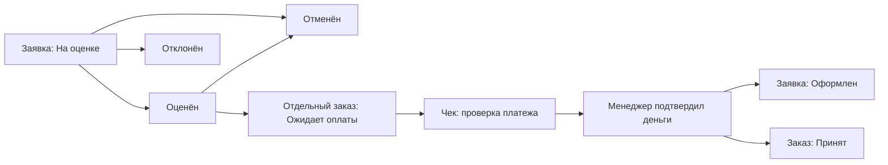

# LOFT Store — требования и фактическое поведение продукта

Актуальность: 17.11.2026. Проверены исходники `loft-store` на `b9b9e99` и `loft-store-admin` на `7355765`. Последующие изменения требуют повторной сверки. «Реализовано» ниже означает подтверждение кодом, а не проверку каждой операции в production.

Связанные документы: [архитектура](ARCHITECTURE.md), [дизайн](DESIGN_SYSTEM.md), [правила агента](../AGENTS.md), [PRD админки](https://github.com/ttta999/loft-store-admin/blob/main/docs/PRD.md).

## 1. Назначение и пользователи

LOFT Store — Telegram Mini App магазина одежды, обуви и аксессуаров. Покупатель выбирает готовый товар либо подаёт заявку на привоз конкретного товара. Менеджер ведёт каталог, проверяет реальные переводы, обрабатывает заказы и возвраты в отдельной веб-админке.

Основные задачи: показать доступный ассортимент и варианты; сохранить контакты и предпочтения; оформить получение и оплату; дать понятную историю; собрать спецзаказ без переписки по каждому полю; обеспечить менеджеру очередь действий. Денежный перевод и его обратный перевод выполняются вне приложения: код фиксирует проверенное менеджером событие.

## 2. Возможности и степень готовности

| Возможность | Подтверждено кодом | Граница реализации |
|---|---|---|
| Каталог, категории, подкатегории, бренды | Активность, фильтрация, сортировка, подборки новых/популярных/скидок | Наличие экрана не подтверждает заполнение каталога |
| Поиск | Поисковый экран, фильтры и сортировка | Не отдельный поисковый сервис |
| Карточка | Фото/галерея, цена, цвет, размеры, избранное, корзина, рекомендации и дополнения | Конкретные рекомендации зависят от данных и доступных вариантов |
| Таблицы размеров | Активные непустые таблицы; товар → подходящий бренд → подкатегория → категория | Нет таблицы — нет кнопки; ошибка проверки отделена от отсутствия |
| Сохранённые размеры | Только подсказка в товаре по ранее сохранённым значениям; отдельного экрана нет | Нет универсального M=42; диапазон/конфликт не даёт конвертации; размер покупки не выбирается автоматически |
| Контакты и адреса | Имя, телефон, получение, несколько сохранённых адресов | Автоподсказки адреса внешним сервисом не реализованы |
| Избранное и корзина | Сохранение на устройстве, варианты/количество, повторная проверка наличия | Это не гарантированный серверный резерв |
| История | Заказы и заявки пользователя, детали и возврат | Незавершённый перевод без чека скрыт; общий серверный журнал клиенту не открыт |
| Поступления | Подписка на отсутствующий вариант, отмена, очередь уведомления | Доставка зависит от наличия, очереди и доступности чата |
| RU/UZ, USD/UZS | Интерфейс, форматирование, сохранение языка аккаунта | Полный перевод всех сообщений бота не завершён |
| Админка | Каталог, заказы, заявки, оплаты, отмены, возвраты, аналитика, задачи, напоминания, рассылки, настройки | Роли/MFA и данные определяет сервер; UI не является разрешением |

Основные клиентские сценарии: каталог → товар → вариант → корзина → оформление; профиль → история → детали; заявка → оценка → отдельное оформление → предоплата → международная цепочка; отсутствующий размер → подписка → ссылка на вариант.

Источники: [маршруты](../src/App.tsx), [страницы](../src/pages), [варианты и поступления](../src/components/RestockControl.tsx), [таблицы и подсказки](../src/lib/sizeCharts.ts), [профиль](../src/pages/ProfilePage.tsx).

## 3. Каталог и варианты

Товар имеет базовую цену в USD, изображения, бренд, категорию/подкатегорию, тип размерной системы и необязательную цену скидки. Цвета могут иметь отдельные фото. Остаток относится к варианту товара, размера и цвета, а не к надписи карточки.

Скидка применяется при включённом общем режиме и положительной `sale_price`. Неактивные категории/подкатегории и товары не должны становиться покупаемыми из старого кеша. Клиент проверяет вариант при добавлении, сервер повторно проверяет при создании заказа. Избранное не резервирует товар.

Таблица размеров не меняет варианты, остатки и историю. Менеджер задаёт проверенные значения производителя и, при необходимости, явные исходную/целевую системы и колонки. Подтверждённая конвертация — подсказка по единственному соответствию для текущей области и существующего размера. При отсутствии такой таблицы [универсальный справочник](../src/lib/sizeConversion.ts) даёт только ориентировочные варианты с отдельной маркировкой и объяснением. Неоднозначная цифровая система не становится точной; неизвестные системы/диапазоны не угадываются. Подробнее: [реализация](../src/lib/productSizeChart.ts), [контракт метаданных](../supabase/migrations/20261117110219_explicit_size_chart_mapping.sql).

## 4. Типы оформления и оплата

| Тип | Получение | Оплата | Начальное состояние |
|---|---|---|---|
| Обычный товар | Самовывоз | `upon_receipt` — при получении | `Активный`, деньги ещё не подтверждены |
| Обычный товар | Самовывоз или доставка | `online_card` — ручной перевод с чеком | `Ожидает оплаты` |
| Новый спецзаказ после оценки | Самовывоз или доставка | Только полная предоплата `online_card` | `Ожидает оплаты`, `special_fulfillment=true` |
| Исторические строки | Сохранённый способ | Сохранённый способ | Читаются с legacy-правилами; массовой конвертации нет |

Имя, телефон формата `+998` и 9 цифр, способ получения, валюта и состав проверяются сервером. Адрес обязателен для доставки. Оплата при получении для доставки запрещена. Реквизиты для перевода настраиваются менеджером, но не являются интеграцией с банком.

Источники: [createOrder API](../api/store.ts), [серверное создание и ограничения](../supabase/migrations/20261111133039_special_order_fulfillment.sql), [клиентский запрет смешивания](../src/lib/specialCheckout.ts).

### Обычный заказ: хранимые статусы и подписи

| Хранимый статус | Покупатель видит | Разрешённый следующий статус |
|---|---|---|
| `Ожидает оплаты` без чека | Ожидает оплаты; черновик не показан в истории | После чека остаётся тот же raw-статус; после подтверждения денег → `Активный` |
| `Ожидает оплаты` с `receipt_submitted_at`, `pending` | На обработке | Подтверждение менеджером → `Активный` |
| `Активный` | Принят | `В обработке` |
| `В обработке`, самовывоз | Собирается | `Готов` |
| `Готов`, самовывоз | Готов к выдаче | `Выдан` |
| `Выдан`, самовывоз | Получен | Терминальный |
| `В обработке`, доставка | Собирается | `Выдан` — прямой переход к курьеру |
| `Выдан`, доставка | Передан курьеру | `Доставлен` |
| `Доставлен` | Доставлен | Терминальный |
| `Отменён` | Отменён клиентом/магазином либо общая подпись | Возобновление запрещено |
| Legacy `Упакован`, доставка | Упакован | `Выдан` |

Для перевода продвижение запрещено до `payment_status='paid'` **и** непустого `paid_at`. Для обычного самовывоза с оплатой при получении переход в raw `Выдан` одновременно фиксирует сумму, валюту, `paid_at` и `payment_status='paid'`. Не надо вручную подменять raw-статусы клиентскими подписями.

Действующие правила: [переходы SQL](../supabase/migrations/20261112172104_streamline_delivery_and_special_notices.sql), [подписи и доступность действий](../src/lib/orderState.ts).

### Момент подтверждения денег

1. Создание перевода резервирует товар, но не подтверждает деньги.
2. Загрузка чека выставляет `receipt_submitted_at`; это свидетельство для проверки.
3. Менеджер проверяет фактическое поступление и вызывает защищённое подтверждение.
4. Сервер проверяет право, состояние и чек; записывает сумму/валюту, `paid_at`, `payment_status`, снимает срок резерва и меняет статус.
5. История/очередь уведомлений обновляются в серверном процессе. Повторное подтверждение не должно повторно списывать остаток.

Платёжное поле отдельно от статуса выполнения:

| `payment_status` | Смысл в текущем workflow |
|---|---|
| `pending` | Деньги не подтверждены; чек может уже ожидать проверки |
| `paid` | Поступление зафиксировано; требуется согласованный `paid_at` |
| `cancelled` | Оплата отменена / денег не найдено в соответствующей ветке |
| `payment_review` | Финансовый разбор отменённого заказа, а не обычная стадия проверки чека активного заказа |
| `refund_pending` | Подтверждённые деньги ожидают обратного перевода |
| `refunded` | Менеджер завершил подтверждение фактического возврата |

[Подтверждение оплаты и возвраты](../supabase/migrations/20261112120358_order_refunds.sql). Автоматического банковского подтверждения, списания с карты покупателя и автоматического возврата денег в доступном коде нет.

## 5. Жизненный цикл спецзаказа

Заявка `china_requests` и её оплачиваемое оформление `orders` — разные сущности, с разными номерами. Цена оценки хранится в USD. Отображение эквивалента использует курс магазина; историческая сумма оформленного заказа берётся из его снимка.

| Статус заявки | Возможное действие | Условия |
|---|---|---|
| `На оценке` | Менеджер → `Оценён` | Положительная цена USD с точностью 2 знака, допустимый комментарий |
| `На оценке` | Менеджер → `Отклонён` | Причина отказа обязательна |
| `На оценке` / `Оценён` | Владелец → `Отменён` | Не конвертирована; временное оформление должно допускать отмену |
| `Оценён` | Создать временный заказ | Только своя незанятая оценка, одна позиция, количество 1 |
| `Оценён` с временным заказом | → `Оформлен` | Для нового `special_fulfillment` только после подтверждения полной оплаты |
| `Оформлен`, `Отклонён`, `Отменён` | Новое продвижение заявки не предусмотрено | Дальнейшее выполнение оформленного заказа идёт в `orders` |

Изменение цены уже оценённой заявки сервером не разрешено как обычная повторная оценка. Идентичный повтор запроса допускается; новые параметры после ухода из `На оценке` отклоняются.

Заказ нельзя смешать с обычным товаром или другим спецзаказом. Смешивание запрещено в корзине, API и SQL; исторические смешанные записи остаются читаемыми. Отмена временного оформления освобождает `reserved_order_id`; она не означает автоматически отказ от самой оценки. Завершённую конвертацию обратно в оценку не открывают.

| Новый заказ спецтовара | Следующий статус |
|---|---|
| `Ожидает оплаты` | `Принят` только после подтверждения денег |
| `Принят` | `Заказан у поставщика` |
| `Заказан у поставщика` | `В пути` |
| `В пути` | `Прибыл в страну` |
| `Прибыл в страну` | `Собирается` |
| `Собирается`, самовывоз | `Готов к выдаче` → `Получен` |
| `Собирается`, доставка | `Передан курьеру` → `Доставлен` |
| Legacy `Упакован` | `Передан курьеру` |

Пропуск этапов и продвижение неоплаченного спецзаказа запрещены. Ссылка курьера необязательна; переданная ссылка валидируется. Поздняя отмена менеджером требует ручного согласования.

Источники: [переходы заявок](../supabase/migrations/20261111124230_special_request_transition_guards.sql), [финализация после денег](../supabase/migrations/20261111173619_special_payment_finalization.sql), [современная цепочка](../src/lib/specialOrders.ts).

## 6. Отмена, остатки и финансовый возврат

### Резерв

Корзина сама резерв не создаёт. `store_create_order` блокирует нужные варианты, проверяет остаток и уменьшает `product_variants.stock` в транзакции. Этот остаток уже исключает резерв. При подтверждении оплаты второй раз он не уменьшается. До первого чека перевод имеет срок резерва 30 минут; сервер проверяет истечение. Успешный `store_save_screenshot` ставит `receipt_submitted_at` и снимает `reservation_expires_at`, поэтому это не общий 30-минутный таймаут для всех уже приславших чек. Дальнейшая проверка денег — действие менеджера. Есть лимит незавершённых резервов: 3 заказа и 10 единиц на пользователя; строки — максимум 50, количество строки — максимум 99.

Отмена освобождает обычные варианты один раз через `stock_released`. Спецтовар не списывает фиктивный складской вариант. Нумерация заказов не является счётчиком видимых строк: удаление/скрытие истории не обещает следующий №1.

### Отмена

- Клиент: начальные `Ожидает оплаты` / `Активный`; для специального состава дополнительно требуется `pending`. UI — предварительная проверка, SQL решает окончательно.
- Менеджер: отдельное действие с причиной. Нельзя маскировать отмену обычным изменением статуса.
- Уже полученный самовывоз и доставленный заказ отменить этим механизмом нельзя.
- Передача курьеру и поздние этапы спецзаказа требуют ручного согласования (`p_manual`).
- Чистый черновик перевода без чека и денег при отказе помечается `checkout_abandoned_at`, исключается из истории, возвращает резерв и не создаёт нового уведомления об отмене. Ожидающие события закрываются; уже отправленный платёжный prompt спецзаказа не отзывается.
- Отмена после чека не равна «денег не было»: нужен финансовый разбор.

### Возврат денег

Это учёт обратного перевода после отмены, а не автоматическая логистика возврата товара.

| Состояние возврата | Действие менеджера | Результат |
|---|---|---|
| `Проверка платежа` | Взять в работу, подтвердить реальные деньги (`payment_received`) | `Ожидает возврата`, фиксируются сумма и валюта |
| `Проверка платежа` | Подтвердить отсутствие денег (`no_payment`) | `Возврат не требуется` |
| `Ожидает возврата` | Прикрепить квитанцию обратного перевода (`proof`) | Статус остаётся; файл защищён |
| `Ожидает возврата` | Подтвердить выполнение (`complete`) | Только с существующей квитанцией → `Возврат выполнен`, заказ `refunded` |
| `Возврат не требуется` | Повторно проверить найденный платёж | С причиной, фактической суммой и валютой → `Ожидает возврата` |
| `Возврат выполнен` | Повторная выплата через этот workflow | Запрещена |

Назначение на менеджера, idempotency key и аудит предотвращают конкурирующие изменения; операции выполняются транзакционно. Сумма подтверждённого платежа ведёт к ожиданию возврата; только чек без подтверждения — к проверке. При отсутствии любых свидетельств оплаты финансовый возврат не создаётся.

Источник: [SQL отмен и возвратов](../supabase/migrations/20261112120358_order_refunds.sql).

## 7. Валюты, округление, доставка

Базовые цены и новая стоимость доставки/порог бесплатной доставки задаются в USD. Клиент может смотреть и оформлять USD/UZS. USD округляется до 2 знаков; UZS — до целых. Сервер сравнивает рассчитанную сумму с просмотренной клиентом; изменение цены/курса/доставки требует повторного оформления, а не скрытого повышения суммы.

Доставка бесплатна, если положительный порог достигнут суммой товаров; самовывоз не имеет платы за доставку. Legacy-настройки в UZS читаются через совместимый пересчёт. Заказ хранит `order_currency`, суммы и `exchange_rate_at_order`: смена текущего курса не меняет историческую сумму. Суммы строк UZS отображаются согласованно с округлённым итогом.

Источники: [money](../src/lib/money.ts), [delivery](../src/lib/delivery.ts), [создание на сервере](../supabase/migrations/20261111133039_special_order_fulfillment.sql).

## 8. Уведомления, задачи и рассылки

Операционные сообщения формируются из серверных событий: новый оформленный заказ/заявка, проверка/подтверждение оплаты, выполнение, оценка, отмена и возврат. Обычный перевод без чека сообщения не порождает. Исключение: новый `special_fulfillment` ставит сообщение «ожидает оплаты» сразу после успешного создания, даже до чека. Отмена снимает неотправленные события, но не отзывает уже доставленное сообщение. Клиент не отправляет произвольный статус от собственного имени. Точные текущие шаблоны: [обычные](../server/orderNotifications.ts), [заявки](../server/specialNotifications.ts), [специальное выполнение](../server/specialOrderNotifications.ts).

| Событие | Адресат и смысл | Источник |
|---|---|---|
| Новая заявка `На оценке` | Менеджеру — новая заявка; клиенту — заявка принята на оценку | `notifications.ts`, `specialNotifications.ts` |
| Заявка `Оценён` | Клиенту — цена/комментарий и предложение оформить отдельно | `specialNotifications.ts` |
| Заявка `Отклонён` / `Отменён` | Клиенту — отказ с причиной / отмена заявки | `specialNotifications.ts` |
| Новый спецзаказ `Ожидает оплаты` | Клиенту — сумма и требование полной предоплаты/чека | `specialOrderNotifications.ts` |
| Обычный чек: стадия `На обработке` | Клиенту — оформление и проверка поступления; менеджеру — первое оформленное поступление заказа | `orderNotifications.ts`, `notifications.ts` |
| Обычный `Принят` | Клиенту — принятие; различается перевод/самовывоз при получении | `orderNotifications.ts` |
| Обычный `Собирается`, `Готов к выдаче`, `Получен`, `Передан курьеру`, `Доставлен` | Клиенту — соответствующий этап; legacy `Упакован` имеет отдельный текст | `orderNotifications.ts` |
| Подтверждён спецзаказ | Клиенту — `Принят`; заявка отдельно получает `Оформлен` со связью на заказ | `specialOrderNotifications.ts`, `specialNotifications.ts` |
| Этапы закупки/пути/прибытия/сборки/получения спецтовара | Клиенту — соответствующий этап; ссылка курьера только при наличии допустимого URL | `specialOrderNotifications.ts` |
| Отмена оформленного заказа | Клиенту/менеджеру — источник/причина и финансовая ветка по сохранённому событию | `cancellationNotification` |
| Проверка/ожидание/завершение финансового возврата | Клиенту — соответствующая проверенная стадия, не обещание уже выполненного перевода до complete | `refundNotification` |
| Нужный вариант снова доступен | Подписанному клиенту — вариант и deep link; доступность проверяется перед отправкой | `restockNotifications.ts` |
| Просроченная рабочая задача | Чату менеджера — если правило/Telegram включены и рабочее окно допускает | `managerReminders.ts` |
| Кампания | Только зафиксированной аудитории с действующим согласием | `campaignDelivery.ts` |

Точный текст не копируется в PRD: он остаётся в связанных серверных шаблонах, чтобы изменение шаблона не создавало второй источник истины.

Очередь имеет уникальный ключ события, claim и повторные попытки. Это не обещание физической exactly-once доставки Bot API при потере сетевого ответа. Для рассылок неоднозначный исход отдельно помечается `uncertain` без слепого повтора.

Центр задач менеджера вычисляет проверку чека, оценку заявки, закупку, сборку, готовый самовывоз и возврат. Настраиваемые напоминания имеют сроки/повтор и рабочее окно. Серверный часовой пояс магазина фиксирован `Asia/Tashkent`; абсолютные даты UI отображаются по устройству. Начальные правила напоминаний в миграции выключены: реальное включение требует проверки настроек.

Рассылки отделены от сервисных сообщений. Нужны отдельное маркетинговое согласие и доступный чат. Аудитория `all` / `buyers` / `brand` учитывает согласие; покупки — подтверждённые. При планировании список фиксируется, перед отправкой согласие проверяется заново. Цели: товар, бренд, категория, новые, скидки, главная. Планирование вводится по местному времени менеджера и сохраняет UTC-инстант. Статусы кампании: `draft` → `scheduled`/`sending` → `completed`/`completed_errors`; отдельная остановка `cancelled`. Подробности менеджера: [PRD админки](https://github.com/ttta999/loft-store-admin/blob/main/docs/PRD.md).

## 9. Границы подтверждения и развитие

| Область | Статус |
|---|---|
| Основные интерфейсы и серверные ограничения выше | Реализовано; конкретный production-сеанс/платёж не выполнялся в ходе документирования |
| Язык бота | Частично: `LanguageSync`, язык предпочтений, поступления и кампании; обычные шаблоны пока содержат русский текст |
| Полный обработчик бота `/start`, webhook, меню | Требует проверки внешнего сервиса: в этих репозиториях такого обработчика не найдено |
| Cron, секреты Vault, фактические доставки, MFA каждого менеджера | Требует эксплуатационной проверки; код не подтверждает активность окружения |
| Интро первого запуска | Обязательный RU/UZ, три экрана; серверное завершение, без повторного просмотра из настроек |
| Внешний WMS/склад и несколько магазинов | Будущие идеи, текущая модель не multi-tenant |
| Плавность на физическом iPhone | Требует ручного тестирования Telegram WebView; эмуляция WebKit не заменяет телефон |

Прежние ТЗ и отчёты в `docs/`, `TESTING.md`, `CACHING.md` описывают этапы на свои даты. При расхождении этот документ — карта текущей реализации, но окончательный источник — действующий код и последняя миграция соответствующей функции. Список расхождений: [архитектура](ARCHITECTURE.md#ограничения-и-расхождения).

## Первый запуск и язык

[Интро](../src/components/Onboarding.tsx) проверяет серверное состояние текущего Telegram-аккаунта. Новый пользователь обязательно сохраняет RU/UZ, затем проходит три экрана или пропускает обучение. Ранее сохранённый язык не спрашивается снова. Завершение идемпотентно; повторный просмотр из настроек удалён. Само интро не меняет URL и исходную цель deep link. Геолокация и IP не используются.

Клиентские системные Telegram-уведомления обычных/специальных заказов, заявок, отмен и возвратов локализованы RU/UZ. Перед недоставленным событием берётся явный язык LOFT, затем поддерживаемый язык подписанного Telegram-профиля, затем RU. Поступления и рассылки используют тот же серверный источник. Смена языка не создаёт событие и не повторяет доставленное. Менеджерские уведомления остаются RU, свободные комментарии не переводятся. Это исходящие сообщения; полного inbound-обработчика бота в репозитории нет.

Подробности, источники размеров и границы проверки: [финальная оптимизация клиента](final-client-optimization.md).

## Уточнения после проверки на iPhone (19.11.2026)

Выбор языка появляется сразу, независимо от загрузки профиля и каталога. Бренд **LOFT Store** имеет постоянную позицию. Три экрана используют общий направленный push; Back меняет направление, быстрые повторные нажатия не запускают конкурирующие переходы. На последнем экране нет «Пропустить». Локальная подсказка завершения ускоряет повторный запуск, но не заменяет серверное состояние или авторизацию.

Раздел «Мои размеры», редакторы и переход из профиля удалены. Старая ссылка `?section=sizes` заменяется профилем. Сохранённые данные, серверные функции и подсказки в товаре остаются.

Брюки и джинсы используют согласованную сетку магазина **36, 38, 40, 42, 44, 46, 48, 50, 52, 54, 56**. Новые варианты в админке числовые. Старые варианты сохраняют исходные значения и остатки; буквенные значения не конвертируются автоматически. В карточке видны только созданные варианты выбранного цвета. Нулевой остаток позволяет подписаться на поступление. Система производителя уточняется отдельно через существующие таблицы размеров.

Кнопка отправки спецзаказа переиспользует компонент основной кнопки корзины; серверная логика заявки не меняется. Причины и границы проверки обратных переходов: [отчёт](iphone-followup-report.md).
